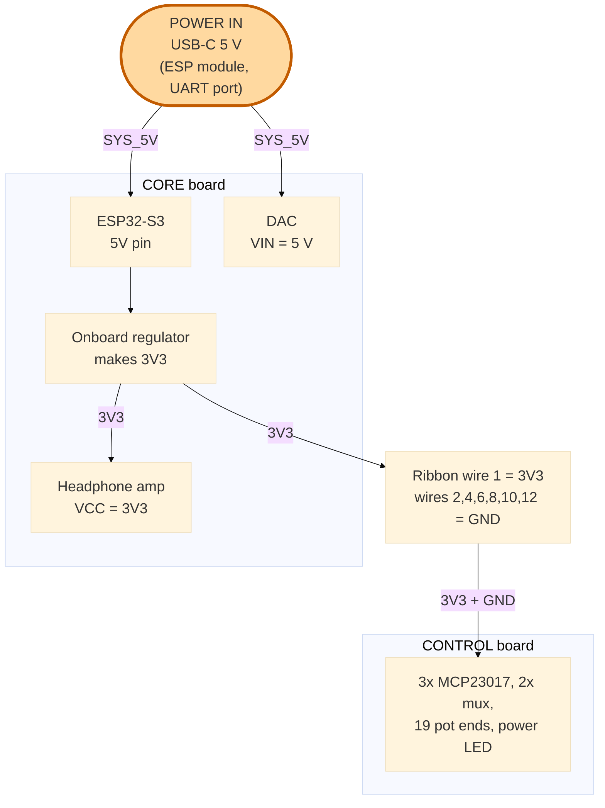
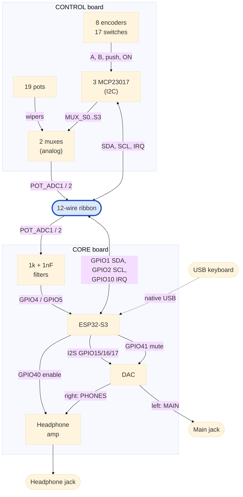

# Compact D R0.5 — plan, block diagram and port map

This is the working plan for the R0.5 hardware. It is the source for the KiCad schematics
(`hardware/split-r0.5/*/…kicad_sch`, generated by `scripts/build_schematics_r05.py`) and is
derived from `hardware/split-r0.5/design-master.json`, `scan.csv`, `controls.csv`, `ribbon.csv`.
Keep this file and those data files in step. Status: detailed design, **not** manufacturing-ready.

## Where the project notes live

| What | Where |
|---|---|
| This plan, block diagram, port map | `docs/plan-r0.5.md` |
| Browsable HTML copy of this plan (generated) | `docs/html/index.html`, published to GitHub Pages |
| Electrical architecture, ribbon pinout, firmware hints | `hardware/split-r0.5/architecture.md` |
| What is still unverified / to measure | `hardware/split-r0.5/remaining-verification.md` |
| Decisions and user changes (Dutch) | `docs/decisions.md` |
| Open points list | `docs/open-points.csv` |
| Original specification (Dutch) | `docs/projectspecification-v1.0.md` |
| Source register / datasheets | `docs/sources.md`, `docs/sources/` |
| Mechanical / enclosure | `mechanical/split-r0.5/README.md` |
| Reports (audit, DRC, schematic PDFs) | `hardware/split-r0.5/reports/` |

## Block diagram 1 — power

Power enters the system at **one point**: the USB-C port of the ESP32 module (the one wired to the
USB-UART chip) on the core board. Everything else is derived from it.

Open: a bus-powered USB keyboard needs 5 V from somewhere; the native USB port may not supply it
(open points O03, O11).

## Block diagram 2 — signals

Arrows show signal direction. The ribbon is the only link between the boards.

Pin-level detail for every arrow is in the port tables below.

## Power

1. USB 5 V enters on the ESP module's USB-UART port → `SYS_5V`.
2. `SYS_5V` feeds the ESP module (5V pin) and the PCM5102 DAC (VIN); CC2 (10 µF) buffers it.
3. The ESP module's onboard regulator makes `3V3`, which feeds CC1, the TPA6132 amp (VCC) and,
   via ribbon wire 1, the whole control board (IO1–3, MX1–2, pot ends, power LED, pull-ups).
4. Ground returns on ribbon wires 2, 4, 6, 8, 10, 12 — each signal wire has an adjacent ground.
5. Budget: pots about 6.3 mA at 3.3 V, control board allowance 50 mA (estimate, not measured).
6. **Open:** native-port VBUS for a bus-powered keyboard, regulator headroom (open points O11, O03).

## Signal flow

**Controls → ESP**
- *Pots:* each pot sits between 3V3 and GND; the wiper (`RVn_W`) goes to one mux input. The ESP
  sets the channel through four select lines `MUX_S0..S3` (driven by MCP outputs GPA7/GPB7 of
  IO1 and IO2, shared by both muxes). The selected wiper leaves on `POT_ADC1` (MX1) or
  `POT_ADC2` (MX2), crosses the ribbon, passes a 1 kΩ/1 nF filter and enters GPIO4 / GPIO5.
- *Switches and encoders:* each contact pulls an MCP input to GND; the MCP's internal pull-ups
  (≈100 kΩ) hold it high. Any change pulls the shared open-drain `PANEL_IRQ` low (RP5 10 kΩ
  pull-up on the core board) so the firmware only reads I²C when something moved.
- *I²C:* GPIO1/GPIO2 at 100 kHz (up to 400 kHz after testing). RP3/RP4 pull-ups are DNP, the
  modules carry their own. RP2 (10 kΩ) holds the three MCP RESET pins high (`IO_RESET`).

**Audio**
1. ESP → DAC over I²S (GPIO15/16/17). DAC runs from its PLL (SCK grounded), I²S format (FMT low).
2. DAC OUTL → `MAIN_RAW` → RA3 100 Ω → `MAIN_LINE` → main jack tip and ring (sleeve = GND).
3. DAC OUTR → `PHONES_RAW` → RA4 10 k / RA5 4k7 divider → `HP_FEED` → TPA6132 inputs
   (L−, R−; L+, R+ to GND) → module's own headphone jack. Main and phones are independent in firmware.
4. GPIO41 `DAC_MUTE_N` drives XSMT (RA6 100 k pull-down), GPIO40 `HP_EN` drives the amp CTRL
   (RA7 100 k pull-down). The DAC's own jack stays inside the case, unused.

## Ribbon (JPANEL ↔ JCORE, pin 1 to pin 1)

| Wire | Net | Role |
|---|---|---|
| 1 | 3V3 | control supply |
| 2 | GND | return |
| 3 | I2C_SDA | ESP GPIO1 ↔ MCP SDA |
| 4 | GND | return |
| 5 | I2C_SCL | ESP GPIO2 ↔ MCP SCL |
| 6 | GND | return |
| 7 | POT_ADC1 | MX1 SIG → core filter RA1/CA1 → GPIO4 |
| 8 | GND | return |
| 9 | POT_ADC2 | MX2 SIG → core filter RA2/CA2 → GPIO5 |
| 10 | GND | return |
| 11 | PANEL_IRQ | MCP INTA (wire-OR) → GPIO10 |
| 12 | GND | return |

## Port map — core board

| ESP32-S3 pin | Net | Goes to | Direction |
|---|---|---|---|
| 5V (USB) | SYS_5V | DAC VIN, CC2 bulk cap | power in from USB-UART port |
| 3V3 | 3V3 | ribbon wire 1, HP1 VCC, CC1 | power out (module regulator) |
| GND | GND | everything | — |
| GPIO1 | I2C_SDA | ribbon 3 → IO1/IO2/IO3 SDA | I²C data |
| GPIO2 | I2C_SCL | ribbon 5 → IO1/IO2/IO3 SCL | I²C clock |
| GPIO4 | POT_ADC1_FILTER | RA1/CA1 filter ← ribbon 7 ← MX1 SIG | ADC in |
| GPIO5 | POT_ADC2_FILTER | RA2/CA2 filter ← ribbon 9 ← MX2 SIG | ADC in |
| GPIO10 | PANEL_IRQ | ribbon 11 ← IO1/IO2/IO3 INTA (RP5 pull-up) | interrupt in |
| GPIO15 | I2S_BCLK | DAC BCK | I²S out |
| GPIO16 | I2S_LRCLK | DAC LCK | I²S out |
| GPIO17 | I2S_TX | DAC DIN | I²S out |
| GPIO40 | HP_EN | HP1 CTRL (RA7 pull-down) | output |
| GPIO41 | DAC_MUTE_N | DAC XSMT (RA6 pull-down) | output |
| native USB | — | USB-MIDI keyboard (host mode) — power path OPEN | USB host |

DAC module pins: VIN←SYS_5V, GND, BCK←I2S_BCLK, LCK←I2S_LRCLK, DIN←I2S_TX, SCK→GND, FMT→GND,
XSMT←DAC_MUTE_N, OUTL→MAIN_RAW, OUTR→PHONES_RAW. Amp module pins: VCC←3V3, GND, L−/R−←HP_FEED,
L+/R+→GND, CTRL←HP_EN, DET unused, OUTL/OUTR→PHONES_L/R. Pin names are functional; **physical
header positions are unverified** (see `remaining-verification.md`).

## Port map — control board

### I/O expanders (MCP23017 modules)
| Module | I²C address | Address straps A0/A1/A2 | GPA7 / GPB7 (outputs) |
|---|---|---|---|
| IO1 | 0x20 | GND / GND / GND | MUX_S0 / MUX_S1 |
| IO2 | 0x21 | 3V3 / GND / GND | MUX_S2 / MUX_S3 |
| IO3 | 0x22 | GND / 3V3 / GND | unused (outputs low) |

Contacts use GPA0–GPA6 and GPB0–GPB6; INTA of each chip goes to `PANEL_IRQ`; INTB unused; RESET to `IO_RESET`.

### Encoders (8)
| Encoder | Function | A / B / push → MCP port |
|---|---|---|
| E1 | osc1.range (RANGE) | A→IO1.GPA0, B→IO1.GPA1, SW1→IO1.GPA2 |
| E2 | osc1.wave (WAVEFORM) | A→IO1.GPA3, B→IO1.GPA4, SW1→IO1.GPA5 |
| E3 | osc2.range (RANGE) | A→IO1.GPA6, B→IO1.GPB0, SW1→IO1.GPB1 |
| E4 | osc2.detune (FREQUENCY) | A→IO1.GPB2, B→IO1.GPB3, SW1→IO1.GPB4 |
| E5 | osc2.wave (WAVEFORM) | A→IO1.GPB5, B→IO1.GPB6, SW1→IO2.GPA0 |
| E6 | osc3.range (RANGE) | A→IO2.GPA1, B→IO2.GPA2, SW1→IO2.GPA3 |
| E7 | osc3.detune (FREQUENCY) | A→IO2.GPA4, B→IO2.GPA5, SW1→IO2.GPA6 |
| E8 | osc3.wave (WAVEFORM) | A→IO2.GPB0, B→IO2.GPB1, SW1→IO2.GPB2 |

### Switches (17, contact closes to GND when ON)
| Switch | Function | Net | MCP port |
|---|---|---|---|
| S1 | mod.osc_enable (Osc mod) | S1_ON | IO2.GPB3 |
| S2 | mod.source_a (Osc3 / EG) | S2_ON | IO2.GPB4 |
| S3 | mod.source_b (Noise / LFO) | S3_ON | IO2.GPB5 |
| S4 | glide.enable (Glide on) | S4_ON | IO2.GPB6 |
| S5 | env.decay_enable (Decay on) | S5_ON | IO3.GPA0 |
| S6 | lfo.shape (LFO shape) | S6_ON | IO3.GPA1 |
| S7 | osc3.keyboard (Osc3 keyboard) | S7_ON | IO3.GPA2 |
| S8 | mix.osc1_enable (Osc 1 on) | S8_ON | IO3.GPA3 |
| S9 | mix.osc2_enable (Osc 2 on) | S9_ON | IO3.GPA4 |
| S10 | mix.osc3_enable (Osc 3 on) | S10_ON | IO3.GPA5 |
| S12 | mix.noise_enable (Noise on) | S12_ON | IO3.GPA6 |
| S13 | noise.type (White / Pink) | S13_ON | IO3.GPB0 |
| S14 | mod.filter_enable (Filter mod) | S14_ON | IO3.GPB1 |
| S15 | filter.keytrack1 (Keytrack 1) | S15_ON | IO3.GPB2 |
| S16 | filter.keytrack2 (Keytrack 2) | S16_ON | IO3.GPB3 |
| S17 | output.main_enable (Main on) | S17_ON | IO3.GPB4 |
| S18 | output.a440 (A-440) | S18_ON | IO3.GPB5 |

### Potentiometers (19) → analog multiplexers
| Pot | Function | Mux | Channel | Net |
|---|---|---|---|---|
| RV1 | master.tune (TUNE) | MX1 | 0 | RV1_W |
| RV2 | glide.time (GLIDE) | MX1 | 1 | RV2_W |
| RV3 | mod.mix (MODULATION MIX) | MX1 | 2 | RV3_W |
| RV4 | lfo.rate (LFO RATE) | MX1 | 3 | RV4_W |
| RV5 | mix.osc1 (VOLUME) | MX1 | 4 | RV5_W |
| RV6 | mix.osc2 (VOLUME) | MX1 | 5 | RV6_W |
| RV7 | mix.osc3 (VOLUME) | MX1 | 6 | RV7_W |
| RV9 | mix.noise (NOISE VOLUME) | MX1 | 7 | RV9_W |
| RV10 | filter.cutoff (CUTOFF FREQUENCY) | MX1 | 8 | RV10_W |
| RV11 | filter.resonance (EMPHASIS) | MX1 | 9 | RV11_W |
| RV12 | filter.env_amount (AMOUNT OF CONTOUR) | MX1 | 10 | RV12_W |
| RV13 | env.filter.attack (ATTACK TIME) | MX1 | 11 | RV13_W |
| RV14 | env.filter.decay (DECAY TIME) | MX1 | 12 | RV14_W |
| RV15 | env.filter.sustain (SUSTAIN LEVEL) | MX1 | 13 | RV15_W |
| RV16 | env.amp.attack (ATTACK TIME) | MX1 | 14 | RV16_W |
| RV17 | env.amp.decay (DECAY TIME) | MX1 | 15 | RV17_W |
| RV18 | env.amp.sustain (SUSTAIN LEVEL) | MX2 | 0 | RV18_W |
| RV19 | output.main_volume (VOLUME) | MX2 | 1 | RV19_W |
| RV20 | output.phones_volume (PHONES) | MX2 | 2 | RV20_W |

Unused MX2 inputs C3–C15 are tied to GND. Both muxes have EN tied low and share `MUX_S0..S3`.

## Discrete parts

RP1 1 kΩ (LED current), RP2 10 kΩ (MCP reset pull-up), RP3/RP4 2k2 **DNP** (I²C pull-ups, only if
needed), RP5 10 kΩ (IRQ pull-up, core), RA1/RA2 1 kΩ + CA1/CA2 1 nF (ADC filters), RA3 100 Ω
(main output series), RA4 10 kΩ / RA5 4k7 (phones attenuator), RA6/RA7 100 kΩ (mute / enable
defaults), CP1/CC1 100 nF, CP2/CC2 10 µF (decoupling / bulk).

## Schematic organisation (how the KiCad sheets follow this plan)

- **Control:** 1 ribbon and power → 2 I/O expanders → 3 analog multiplexers → 4 potentiometers →
  5 encoders → 6 switches. Blocks connect by named net labels, left-to-right, one section per frame.
- **Core:** 1 ribbon and power → 2 ESP32-S3 → 3 pot filters → 4 DAC → 5 outputs (main jack, phones amp).
- Standard KiCad symbols are used for R, C, LED, potentiometer, encoder, SPDT switch, jacks and
  connectors. Purchased modules are block symbols with their functional pin names; their pin
  numbers are placeholders until the physical headers are measured.
